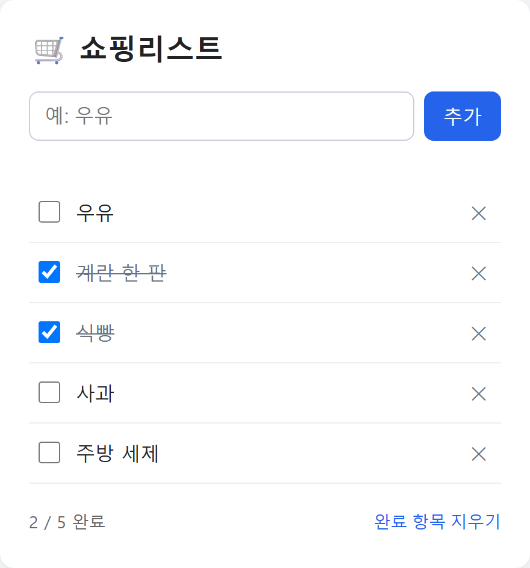

# 🛒 쇼핑리스트

HTML·CSS·순수 JavaScript로 만든 간단한 쇼핑리스트 웹 앱입니다. 빌드 과정이나 서버 없이 브라우저에서 바로 동작하며, 목록은 브라우저의 `localStorage`에 저장됩니다.

<p align="center">
  
</p>

## 주요 기능

- **아이템 추가** — 앞뒤 공백은 자동으로 지우고, 최대 100자까지 입력할 수 있습니다.
- **입력 검사** — 빈 입력이나 공백만 입력하면 에러 메시지를 보여 줍니다.
- **중복 방지** — 아직 완료하지 않은 같은 이름(대소문자 무시)은 다시 추가되지 않습니다. 완료된 항목과 같은 이름은 다시 살 수 있도록 추가할 수 있습니다.
- **완료 체크** — 체크박스나 이름을 눌러 완료/취소합니다. 체크를 풀 때 같은 이름의 미완료 항목이 있으면 하나로 합칩니다.
- **삭제 / 완료 항목 지우기** — 항목을 하나씩 지우거나, 완료한 항목을 한 번에 지울 수 있습니다.
- **진행 상황 표시** — `완료 수 / 전체 수`를 아래쪽에 보여 줍니다.
- **자동 저장** — 새로고침해도 목록과 완료 상태가 유지됩니다. 저장 데이터가 깨져 있으면 빈 목록으로 안전하게 시작합니다.
- **탭 간 동기화** — 다른 탭에서 목록을 바꾸면 현재 탭에도 바로 반영됩니다.

## 접근성과 안전성

- 화면 읽기 프로그램이 추가·완료·삭제 같은 변경 내용을 읽어 줍니다(`aria-live`).
- 에러는 입력창과 연결되어(`aria-invalid`, `aria-describedby`) 입력창에서도 이유를 들을 수 있습니다.
- 삭제나 체크 후에도 키보드 포커스가 자연스러운 위치로 이동합니다.
- 누르는 영역이 24px 이상이고, 키보드로 이동할 때 포커스 테두리가 보입니다.
- 아이템 이름은 `textContent`로 넣어 HTML이 실행되지 않습니다(XSS 방지).
- 좁은 화면에서도 가로 스크롤이 생기지 않는 반응형 레이아웃입니다.

## 실행 방법

`index.html` 파일을 브라우저로 열면 바로 사용할 수 있습니다.

로컬 서버로 띄우고 싶다면 함께 들어 있는 정적 서버를 사용하세요(Node.js 필요).

```bash
node tests/static-server.js 8765
# 브라우저에서 http://127.0.0.1:8765 접속
```

## 테스트

[Playwright](https://playwright.dev/)로 작성한 E2E 테스트가 들어 있습니다. 테스트를 실행하면 정적 서버가 자동으로 켜집니다.

```bash
npm install
npx playwright install chromium   # 처음 한 번만
npm test                          # 테스트 실행
npm run test:headed               # 브라우저 창을 띄워서 실행
npm run test:report               # HTML 리포트 열기
```

기본 포트는 `8765`입니다. 다른 서버와 겹치면 `PORT` 환경 변수로 바꿀 수 있습니다(예: `PORT=9000 npm test`).

## 스크린샷 다시 찍기

화면 디자인을 바꾼 뒤에는 아래 명령으로 README의 스크린샷(`docs/screenshot.png`)을 새로 만들 수 있습니다. 예시 아이템 5개를 넣고 2개를 완료 처리한 화면을 찍습니다.

```bash
npm run screenshot
```

## 파일 구성

```
├── index.html             # 화면 구조
├── style.css              # 스타일 (반응형, 포커스 표시)
├── app.js                 # 앱 동작 (추가·완료·삭제·저장·동기화)
├── playwright.config.js   # 테스트 설정
├── package.json
├── docs/
│   └── screenshot.png     # README용 앱 스크린샷
├── scripts/
│   └── screenshot.js      # 스크린샷 자동 촬영 스크립트
└── tests/
    ├── shopping-list.spec.js  # E2E 테스트
    └── static-server.js       # 테스트용 정적 파일 서버 (Node 내장 모듈만 사용)
```
